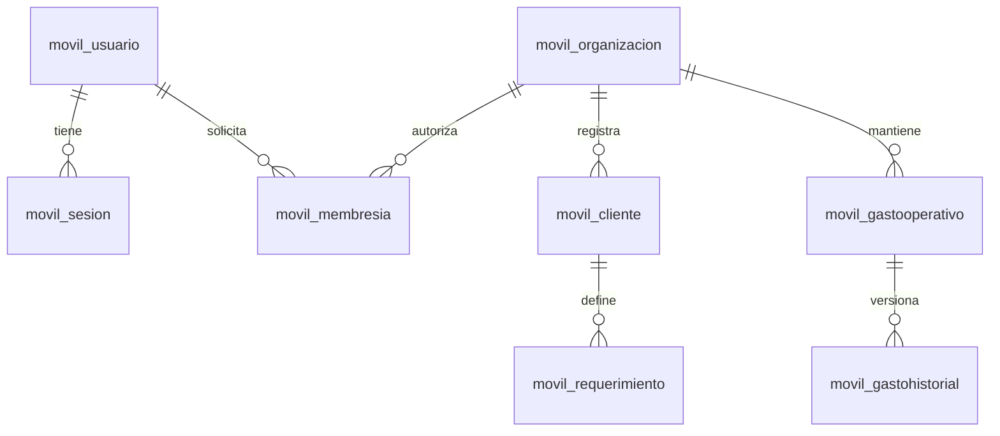

# Base de datos de la aplicación móvil

La app usa una única base PostgreSQL/Neon para todas las empresas, con separación por organización. Es distinta de la base del sistema web. El alias Django `movil` solo acepta `NEON_MOBILE_DATABASE_URL`; no utiliza la conexión antigua ni SQLite cuando falta esa variable.

El esquema está versionado en las [migraciones](servidor/movil/migrations/), incluida [0002_ventas_pago_completo.py](servidor/movil/migrations/0002_ventas_pago_completo.py), y sus modelos en [models.py](servidor/movil/models.py). No es necesario ejecutar el SQL original ni copiar los esquemas `auth` o `neon_auth`: la app tiene sus propias cuentas, sesiones y membresías.



| Tabla | Función |
| --- | --- |
| `movil_usuario` | Datos personales; usuario, correo y teléfono únicos; contraseña con hash. |
| `movil_sesion` | Hash del token, vencimiento y revocación. |
| `movil_limiteacceso` | Contadores compartidos para limitar registro e inicio de sesión. |
| `movil_organizacion` | Empresa, nombre y descripción. |
| `movil_membresia` | Organización, usuario, rol y estado de acceso. |
| `movil_cliente` | Prospecto y venta cobrada completa con importe y fecha de venta. |
| `movil_requerimiento` | Título, descripción, orden y estado del trabajo de una venta. |
| `movil_gastooperativo` | Gasto recurrente de una organización. |
| `movil_gastohistorial` | Versiones del gasto vigentes desde cada mes. |

Cada usuario puede tener una organización aceptada o una solicitud pendiente. Un rechazo o eliminación permite volver a solicitar acceso. Las invitaciones al crear una organización se asignan a usuarios registrados y disponibles. El administrador puede aceptar o rechazar solicitudes, asignar un rol y retirar miembros; no puede eliminar su propia membresía.

Una venta crea la entrada pendiente de requerimientos sin duplicar al cliente. Al guardar requerimientos, el proyecto pasa a gestión. Cada venta se cobra en su totalidad: Finanzas cuenta `monto_venta` una sola vez en `fecha_venta`. El cliente y los reportes no almacenan ni desglosan pagos parciales. Se conserva el historial de gastos y el alcance parcial de los reportes.

La migración `0002_ventas_pago_completo` conserva los montos y las fechas de venta válidas y retira los campos del flujo anterior de pagos. Si falta una fecha válida, recupera una fecha histórica conocida sin asignar fechas futuras; cuando no existe ninguna, el reporte advierte que falta información. Ejecuta `migrate movil --database=movil` antes de reiniciar el backend actualizado.

## Instalación en Neon

Si prefieres usar el SQL Editor de Neon, los archivos listos para ejecutar están en [sql/README.md](sql/README.md): [crear la base](sql/01_crear_base.sql) e [instalar el esquema completo](sql/02_esquema_aplicacion.sql).

En este entorno ya se crearon la base `aplicacion_movil` y el rol dedicado `aplicacion_movil_app`, y se guardó `NEON_MOBILE_DATABASE_URL` en el archivo privado del servidor. El archivo `.env` está excluido de Git. Usa el verificador en solo lectura para comprobar las nueve tablas, sus columnas y la migración vigente. Reinicia Django después de actualizar el esquema.

Los pasos siguientes sirven para instalar el proyecto en otro entorno:

1. Crea una base vacía llamada `aplicacion_movil`, distinta de la base web. Puede estar en un proyecto propio o en otra base de la misma rama. Utiliza un rol dedicado con permisos sobre esa base.
2. Guarda su conexión privada como `NEON_MOBILE_DATABASE_URL` en `backend/servidor/.env`. Nunca la pongas en una variable `EXPO_PUBLIC_*`.
3. Desde la raíz del proyecto ejecuta:

```powershell
.\backend\.venv\Scripts\python.exe backend/servidor/manage.py migrate movil --database=movil
.\backend\.venv\Scripts\python.exe scripts/verificar-base-movil.py
```

Las migraciones crean o actualizan las nueve tablas móviles y el registro de migraciones en esa base. No se ejecutan contra `neon` ni contra la base del sistema web. El router impide crear tablas de otras aplicaciones en `movil`. La configuración rechaza reutilizar la misma base original, incluso con otro usuario o el host pooler de Neon.

Para revisar el SQL antes de instalar, una vez configurada la conexión:

```powershell
.\backend\.venv\Scripts\python.exe backend/servidor/manage.py sqlmigrate movil 0001 --database=movil
```

Referencia oficial: [administrar bases en Neon](https://neon.com/docs/manage/databases).
